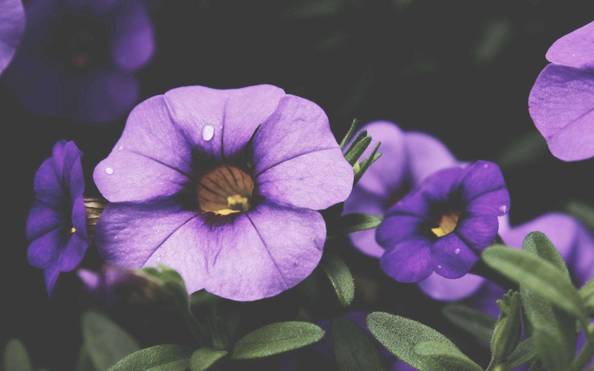

An image next to this post, at its natural size:

![[petunias.jpg]]

The same image, 400 pixels wide:

![[petunias.jpg|400]]

With alt text and a fixed size:

![[petunias.jpg|purple petunias after rain|320x200]]

Standard markdown with a caption:

A shared image from `content/attachments/`, used by any post:

![[water-lily.jpg|360]]

Images can sit inside a sentence too, like this small lily ![[water-lily.jpg|24]] next to the text.

> [!TIP]
> ![[water-lily.jpg|160]] Embeds work inside alerts, lists and tables as well.
